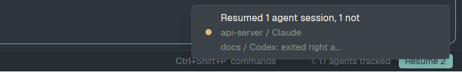

# herdr-agent-resume-plus

**Bring Claude Code, Codex, opencode and pi sessions back after a reboot, in the [Herdr](https://herdr.dev) desktop app.**

When the machine restarts (or herdr-core does), Herdr brings every tab and split back, but each terminal comes back as a bare shell: the agent that was running there is gone. The Herdr TUI used to resume agents; the app doesn't. This mod brings that back, for four agents, sub-agents included, without installing hooks into any agent's settings.



After a reboot, each terminal that lost its agent gets its resume command typed into its shell, in the agent's folder and with the flags it was started with:

| Was running | Typed into the restored shell |
|---|---|
| Claude Code | `cd '<folder>' && claude --resume <session> [flags]` |
| Codex | `cd '<folder>' && codex resume <session> [flags]` |
| opencode | `cd '<folder>' && opencode -s <session> [flags]` |
| pi | `cd '<folder>' && pi --session <file> [flags]` |

A notification says what came back, and what didn't and why.

## How it differs from herdr-agent-resume

[thuanlm215/herdr-agent-resume](https://github.com/thuanlm215/herdr-agent-resume) solves the same problem, and this mod borrows its flag lists and the shape of its resume pass (with credit, see [LICENSE](LICENSE)). The differences:

| | herdr-agent-resume | herdr-agent-resume-plus |
|---|---|---|
| Agents | Claude Code, Codex | Claude Code, Codex, **opencode, pi** |
| How sessions are found | `SessionStart` hooks added to `~/.claude/settings.json` and `~/.codex/hooks.json` | **No hooks**: it reads the running processes (`/proc`) every 15 s |
| After a reboot | press Ctrl+Shift+R, or `--auto` lines in your shell's rc file | **resumes by itself** from a status-bar block, only after a real reboot (the machine's `boot_id` changed); after a core restart alone a **Resume** button appears |
| Sub-agents | not noted | **resumed, and their parent is told** which children came back and that their in-flight work was lost |
| Folders with a quote in the name | skipped | escaped and resumed |
| macOS | yes (flags not restored) | not yet ([issues](../../issues)) |

Both: launch flags restored, each resume checked, sessions skipped with a reason, a dry run, a log.

## Install

```sh
git clone https://github.com/manastalukdar/herdr-agent-resume-plus
python3 herdr-agent-resume-plus/scripts/install.py
```

The installer:

- runs `herdr-app check` and copies `mods/agent-resume-plus/` to `~/.config/herdr-app/mods/` (it won't overwrite an existing copy);
- binds **Alt+Shift+R** to a manual resume pass in `keys.json`, unless that key is already in use (then it tells you);
- adds the mod's 230px block at the right of the current layout's status bar. The block has to be in a layout: it's what runs in the background and resumes after a reboot. If the current layout is one of Herdr's own (`main`, ...), which Herdr replaces on every start, it's cloned first as `<name>-resume` and switched to. A layout of your own is edited in place, after a backup in `~/.config/herdr-app/data/agent-resume-plus/backups/`.

`--dry-run` shows what would change, `--update` copies a newer mod over an install, `--uninstall` takes the block and the key out and removes the mod (your tracked sessions and log in `data/agent-resume-plus/` stay).

Needs Linux, Herdr app, herdr-core, and Python 3.8+ (standard library only). Tested with Herdr app 0.1.11 and herdr-core 0.1.16 on Fedora 44.

## Using it

- **The status-bar block** shows `↻ N agents tracked`. When a terminal has lost its agent and wasn't resumed automatically, a **Resume N** button appears next to it.
- **After a reboot**, sessions come back by themselves when Herdr starts: it waits up to 12 s for restored shells, lets each run 1.5 s, types the commands, then checks 5 s later that each agent is up.
- **Alt+Shift+R** runs the same pass by hand at any time (a small popup while it works). With nothing lost it says so.
- **Quitting an agent yourself** (its shell stays) forgets its session, so it won't come back.
- **Closing a tab** forgets its sessions too.

Dry run, without typing anything:

```sh
python3 ~/.config/herdr-app/mods/agent-resume-plus/agent_session.py status
```

It lists every tracked session with the exact command a resume would type, and what a pass would do right now. What the mod did is logged in `~/.config/herdr-app/data/agent-resume-plus/log.jsonl` (resume, fail, skip, forget), rolling over at 256 KB.

## How it works

Three pieces in `mods/agent-resume-plus/`:

1. **`main.js`, the block.** Every 15 s it lists herdr-core's terminals (`hc ls`) and, for each one running an agent, asks the helper which session it is. It keeps a map per terminal (agent, session, command, flags, folder, conversation file, the terminal's creation time, the boot it was seen in, its sub-agent parent) in `data/agent-resume-plus/map.json`. A session is re-read only when the agent's turn, status or process changed, plus a full pass every 5 minutes (to catch a `/clear` between turns); bare shells it isn't tracking are skipped.
2. **`agent_session.py`, the helper.** Given a process and its folder, it walks the process tree in `/proc` and finds the agent and its current session: Claude Code from `~/.claude/sessions/<pid>.json`, Codex from the rollout file its process keeps open, opencode from `--session` or its database, pi from `--session` or its newest session file. It also returns the launch flags worth keeping (an allowlist per agent; never a prompt, a session picker or an API key) and the conversation file.
3. **`plan.js`, the decisions** (pure, tested). A terminal has lost its agent when herdr-core re-created it (a new `created_ms`) and a shell is in front. For those it builds what to type, or skips with a reason: the session is open in another terminal, already resumed in this pass, its folder is gone, its conversation file is gone, or its folder name has a control character. A parent that's resumed gets a note about its resumed children as its first message; a parent still running gets it by `hc send`.

## Watch out

- **A folder Claude Code hasn't been told to trust** stops at its trust prompt after the resume. Folders you've worked in are trusted already.
- **opencode and pi without `--session`:** the session is the newest one in that folder since the agent started. Two of them in the same folder can swap.
- **Launch flags:** only an allowlist comes back (see `KEEP_FLAGS` in `agent_session.py`). A flag that takes several values (`--add-dir /a /b`) stops at a value with a space in it, taken to be the prompt that follows; a path with a space in such a list is dropped.
- The command is typed into your shell (`hc send`), so it lands in your shell history.
- Like the Herdr TUI's resume, this relies on how each agent CLI resumes today. If a CLI changes its resume flags or where it keeps sessions, it can break.

Known gaps and planned work are tracked in [issues](../../issues): macOS, remote machines, and keeping the state on the terminals instead of in `map.json`.

## Development

```sh
node mods/agent-resume-plus/plan.test.mjs
python3 -I mods/agent-resume-plus/agent_session.py --test
herdr-app check mods/agent-resume-plus
```

CI runs the first two. The full spec, to rebuild it from scratch, is in [RECIPE.md](RECIPE.md).

## Credits

[herdr-agent-resume](https://github.com/thuanlm215/herdr-agent-resume) by thuanlm215: the Claude Code and Codex flag tables and the resume pass's checks. The resume commands follow the Herdr TUI's.

## License

MIT. See [LICENSE](LICENSE).
