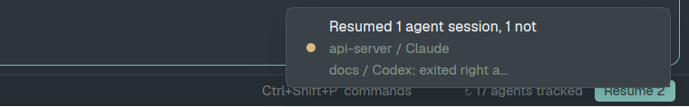

# Agent Resume Plus

A 230px block at the right of the status bar that keeps track of the agent session running in each terminal (Claude Code, Codex, opencode, pi) and, when a reboot gives the terminals back as bare shells, types each one's resume command back in: in its folder, with its launch flags, telling parent agents which of their sub-agents came back.

## What you see

- **The block**, 230px wide and as tall as the status bar (28px), background `chrome` with a 1px `border` line on top, content right-aligned with 12px padding and 10px gaps, text 11.8px:
  - `↻ N agents tracked` in `dim`, N being the sessions it currently knows;
  - when lost sessions are waiting: a **Resume N** button, 8px side padding, 4px corners, `accent` background with `accent_foreground` text, 85% opacity on hover;
  - when the last check failed: `resume: <error>` in `blocked` in place of the count.
- **The popup** (the mod opened as an overlay by its key, 340 by 64): "Looking for agent sessions to resume…", 13px `foreground` on `background`, centered, 16px padding. It closes by itself when the pass is done.
- **The notification** (Herdr's toast) after a pass: title "Resumed N agent sessions" (or "Auto-resumed …" after a reboot, ", M not" when some didn't), or "Couldn't resume N agent sessions"; body one line per terminal, by its `where` label (space / tab), with the reason for each one that didn't come back. `success` when all came back, `warning` otherwise. With nothing to resume, from the key: "No agent sessions to resume", `info`.

## How it behaves

- No agent statuses of its own: it shows a count and a button, not working/blocked/done/idle.
- Every 15 s it checks herdr-core's live terminals. A terminal running an agent gets its session recorded; a session is re-read only when its turn, status or foreground process changed, and every 20th check re-reads all.
- A terminal whose agent you quit (same terminal, shell in front again) is forgotten. A terminal that's gone from `hc ls` is forgotten.
- A terminal herdr-core re-created (its `created_ms` changed; for entries saved before that was recorded, its shell pid changed) with a shell in front has lost its agent.
- When the block starts (Herdr starting), it waits up to 12 s while tracked terminals have no foreground process yet, then resumes by itself only the lost sessions recorded in another boot (`/proc/sys/kernel/random/boot_id` differs). Others wait for the Resume button or the key.
- A pass: skip what's open in another terminal, already resumed in this pass, has its folder or conversation file gone, or has a control character in its folder; for each remaining terminal still at a shell, wait until its shell has run 1.5 s, `hc send` the command; send parents their note; wait 5 s; a terminal with its shell in front again failed ("exited right away: <the agent's last line>", from `hc read`).
- Clicking **Resume N** runs a pass for the lost sessions. **Alt+Shift+R** (`mod.open:agent-resume-plus`) opens the popup, which checks once and runs a pass.

## Built from

- **Mod** `mods/agent-resume-plus/`, `place: "none"`, `size: 28`, `overlay: {width: 340, height: 64}`:
  - `main.js`: the view. `init` loads `data/agent-resume-plus/map.json`, checks, then either runs the popup pass and `closeOverlay`, or waits for restored shells and auto-resumes; `cx.timer.every(15000)` checks (not in the popup). `log()` appends to `log.jsonl` through `sh`; `writeStatus()` writes `status.json` for the dry run.
  - `plan.js`: pure functions `plan(lost, {open, folderOk, fileOk})` → `{todo, skipped}`, `command(entry)`, `lastWords(screen)`; tested by `plan.test.mjs` (`node`).
  - `agent_session.py`: `agent_session.py <pid> <cwd>` prints `{app, session, cmd, flags, transcript}` or `{}`; `status` prints the dry run; `--test` self-checks. Standard library only.
- **Layout**: none of its own. A block `{"id": "agent-resume-plus", "type": "block", "content": {"mod": "agent-resume-plus"}, "size": {"px": 230}}` in the status bar's row (the installer wraps Herdr's `workspace-status` block in a row when needed).
- **Keys**: `keys.json`, `"global": {"alt-shift-r": "mod.open:agent-resume-plus"}`.
- **herdr**: `hc` (`ls`, `get`, `send`, `read`), `exec` (`/usr/bin/python3 -I agent_session.py`, `/bin/sh`, `/bin/sleep`, `/bin/cat`), `appHome`, `readTextFile` / `writeTextFile`, `notify`, `props`, `closeOverlay`, `theme`.
- **Session sources**: `~/.claude/sessions/<pid>.json` and `~/.claude/projects/*/<id>.jsonl`; the Codex rollout file held open by the Codex process (`/proc/<pid>/fd`); `--session`/`-s` or `~/.local/share/opencode/opencode.db` (`session_v2`, read-only); `--session` or `~/.pi/agent/sessions/--<cwd>--/*.jsonl`.

## Watch out

- Mods have no `setTimeout`: waits inside `cx.spawn` use `exec("/bin/sleep")`.
- `hc send` pastes and presses Enter, so a command with a newline would run early: refuse folders and flags with control characters.
- Only flags on an allowlist come back; never `--resume`, `--continue`, `-p`/`--print`, a prompt, or pi's `--api-key` (it would be saved to disk).
- A "+" flag (`--add-dir /a /b`) stops at a value with a space, taken to be the prompt after it.
- Claude Code may stop at its folder-trust prompt after a resume; the pass counts that as started.
- Linux only (`/proc`); local terminals only (addresses without `machine/`).
- One copy in the layout. The popup is a second copy for one pass; two passes at once could type the same command twice.

## Done when

- `herdr-app check mods/agent-resume-plus`, `node plan.test.mjs` and `python3 agent_session.py --test` pass.
- With Claude Code running in a terminal, the block counts it, and `agent_session.py status` shows `cd '<folder>' && claude --resume <id>` for it.
- `hc server restart` (or a reboot) gives the terminal back as a shell; the Resume button appears (after a reboot: the session comes back by itself) and resumes it on the same conversation.
- Quitting that agent yourself drops it from the count.
- A resume whose agent exits at once is reported with its last line.
